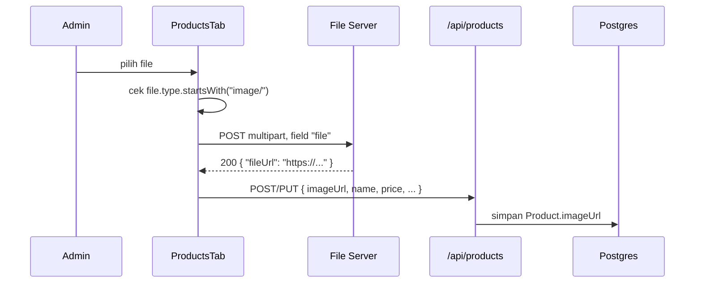

# Upload Foto dari UI

Ada tiga jalur gambar di aplikasi ini. Pahami bedanya sebelum mengubah kode.

| Jalur | Lokasi UI | Cara simpan | File di-upload? |
|---|---|---|---|
| Foto produk | Admin → Utility → QRIS → tab Produk | URL hasil file server → `Product.imageUrl` | Ya, ke file server eksternal |
| Foto profil | Halaman Daftar (`/auth/signUp`) | Base64 data URL → `User.image` | Tidak, ikut payload sign-up |
| Gambar QRIS | Admin → Utility → QRIS → tab Akun QRIS | Hanya dibaca jadi payload teks | Tidak, decode lokal di browser |

## Prasyarat

Isi env berikut di `.env` / `.env.example`:

```bash
NEXT_PUBLIC_FILESERVER_URL=https://fileserver.contoh.com/upload
```

`NEXT_PUBLIC_` berarti nilainya dikirim ke browser. Tanpa variabel ini, tombol upload produk menampilkan error `File server belum diatur.`

## 1. Upload foto produk

Halaman: `/dashboard/admin/utility/qris/products` (tab **Produk**).

Langkah:

1. Buka tab **Produk**, klik **Tambah produk** atau ikon pensil pada produk yang ada.
2. Di bagian **Gambar produk**, klik **Upload gambar**.
3. Pilih file gambar (JPG/PNG).
4. Tombol berubah jadi **Mengunggah...** dan spinner tampil di kotak preview.
5. Setelah sukses, preview muncul dan URL otomatis terisi di kolom teks di bawahnya.
6. Klik simpan. URL dikirim ke API produk sebagai `imageUrl`.

Alternatif tanpa upload: tempel URL gambar langsung di kolom `atau tempel URL gambar`.
Tombol **X** di preview menghapus gambar (`imageUrl` jadi `""` → dikirim sebagai `null`).

Alur teknis:



Kontrak file server yang diharapkan:

- Request: `POST` multipart/form-data, satu field bernama `file`.
- Response sukses: HTTP 2xx + JSON `{ "fileUrl": "https://..." }`.
- Response gagal: HTTP non-2xx atau tanpa `fileUrl`; field `message` dipakai sebagai pesan toast (fallback: `Gagal mengupload gambar`).

Kode: `components/qris/ProductsTab.tsx` (`uploadImage`).

Gambar yang tersimpan dipakai di:

- `components/pos/PosTerminal.tsx` — katalog kasir.
- `components/order/TableOrderClient.tsx` — order mandiri via QR meja.

## 2. Upload foto profil saat daftar

Halaman: `/auth/signUp`.

1. Isi form, pilih file di field foto.
2. Batas ukuran **2 MB**; lebih dari itu muncul `Ukuran foto maksimal 2 MB.`
3. File dibaca `FileReader` menjadi base64 (preview langsung tampil).
4. Saat submit, base64 dikirim di field `image` pada `signUp.email`.
5. Hapus foto lewat tombol **X** di preview.

Tidak ada request terpisah ke file server. Ukuran payload sign-up naik sebesar ukuran file (+33% base64).

Kode: `app/(public)/auth/signUp/page.tsx` (`handleImageChange`, `convertImageToBase64`).

## 3. Upload gambar QRIS (bukan upload permanen)

Halaman: `/dashboard/admin/utility/qris/accounts` (tab **Akun QRIS**).

1. Klik **Tambah akun QRIS**.
2. Klik **Upload gambar QR**, pilih PNG/JPG berisi QRIS statis.
3. Browser men-decode QR (jsQR, maksimal 1600 px) dan mengisi **Payload QRIS statis**.
4. File tidak dikirim ke mana pun dan tidak disimpan; yang disimpan hanya payload teks.

Gagal decode → toast `QR code tidak terbaca dari gambar`.

Kode: `components/qris/decodeQr.ts`, `components/qris/QrisAccountsTab.tsx` (`onPickImage`).

## Troubleshooting

| Gejala | Penyebab | Perbaikan |
|---|---|---|
| `File server belum diatur.` | `NEXT_PUBLIC_FILESERVER_URL` kosong | Isi env, restart dev server |
| `File harus berupa gambar.` | MIME bukan `image/*` | Pakai JPG/PNG |
| `Gagal mengupload gambar` | File server error / response tanpa `fileUrl` | Cek endpoint, CORS, dan bentuk response |
| Upload sukses tapi gambar tidak tampil di POS | URL relatif atau host tidak bisa diakses dari browser | Pastikan `fileUrl` absolut dan publik |
| Foto profil ditolak | File > 2 MB | Kompres dulu |

CORS: file server harus mengizinkan `POST` dari origin aplikasi (termasuk preflight `OPTIONS`).
